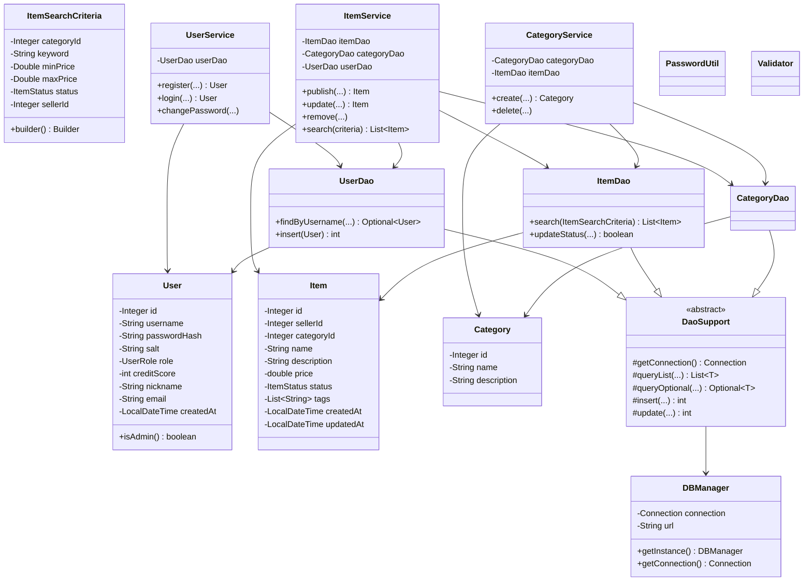
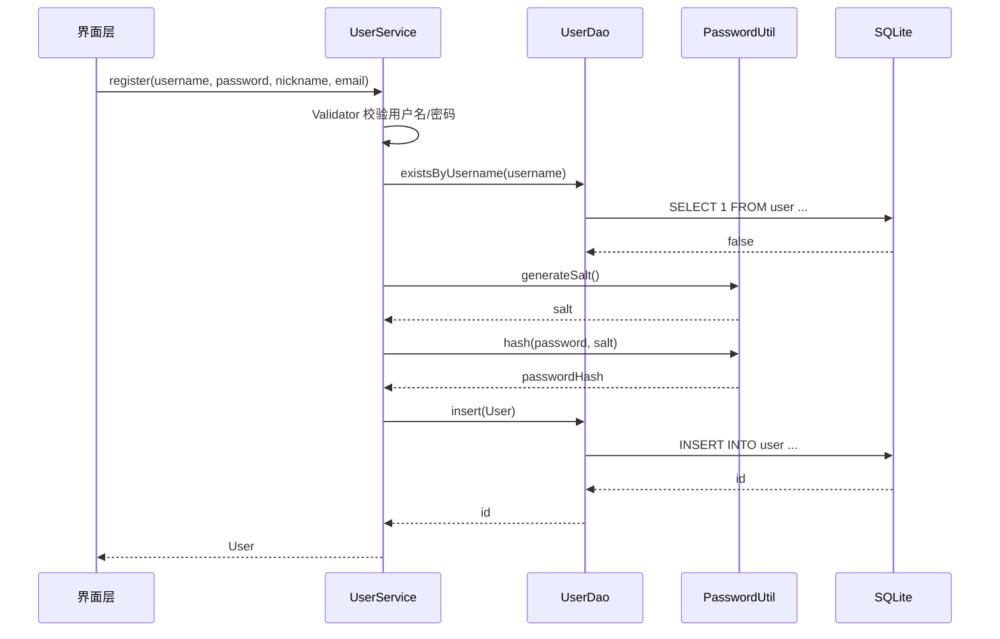
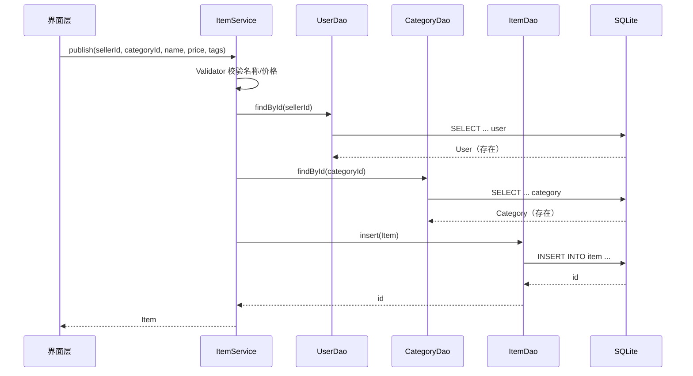

# 低碳校园资源循环流转桌面系统 —— 系统设计说明书

## 1. 总体架构

采用经典三层分层架构，配合「实体 ADT + DAO 数据访问 + Service 业务逻辑」组织，
关注点分离，便于测试与后续 GUI 接入。

```
┌─────────────────────────────────────────────────────┐
│  UI 层（迭代 3：Swing GUI，事件驱动）                │
├─────────────────────────────────────────────────────┤
│  Service 层（业务逻辑、规则校验、权限、事务边界）     │
│    UserService  ItemService  CategoryService ...     │
├─────────────────────────────────────────────────────┤
│  DAO 层（JDBC 数据访问，DAO 模式）                   │
│    UserDao  ItemDao  CategoryDao ...  (extends DaoSupport) │
├─────────────────────────────────────────────────────┤
│  基础设施层（util / db / exception）                 │
│    DBManager(单例) PasswordUtil Validator ...        │
├─────────────────────────────────────────────────────┤
│  SQLite 数据库                                       │
└─────────────────────────────────────────────────────┘
```

依赖方向自上而下：UI → Service → DAO → DB。`model` 实体被各层共享，`exception`
为贯穿各层的错误契约。

## 2. 模块划分（包结构）

| 包 | 职责 | 对应课程章节 |
| --- | --- | --- |
| `com.campus.recycle.model` | 业务实体 ADT + 枚举 + 检索条件 | 第 3 章 面向对象 |
| `com.campus.recycle.dao` | JDBC 数据访问层（DAO 模式） | 第 8 章 应用数据库 |
| `com.campus.recycle.service` | 业务逻辑与规则校验 | 第 2 章 模块化 |
| `com.campus.recycle.util` | 连接管理、密码、校验等横切工具 | 第 4 章 防御性编程 |
| `com.campus.recycle.exception` | 统一业务异常体系 | 第 4 章 异常处理 |
| `com.campus.recycle.db` | 建表与种子数据初始化 | 第 8 章 数据库 |
| `com.campus.recycle.ui`（迭代 3） | Swing GUI | 第 7 章 GUI |

## 3. UML 类图



## 4. 时序图

### 4.1 用户注册



### 4.2 物品发布



## 5. 模块接口约定

各 Service 对外提供稳定接口，UI 层只依赖 Service，不直接触碰 DAO/DB：

| 接口 | 输入 | 输出 | 异常 |
| --- | --- | --- | --- |
| `UserService.register` | username, password, nickname, email | `User` | `ValidationException` / `DuplicateResourceException` |
| `UserService.login` | username, password | `User` | `ValidationException` |
| `ItemService.publish` | sellerId, categoryId, name, desc, price, tags | `Item` | `ValidationException` / `NotFoundException` |
| `ItemService.update` | itemId, operatorId, ... | `Item` | `NotFoundException` / `PermissionDeniedException` |
| `ItemService.remove` | itemId, operatorId | void | `NotFoundException` / `PermissionDeniedException` |
| `ItemService.search` | `ItemSearchCriteria` | `List<Item>` | — |
| `CategoryService.create` | name, description | `Category` | `ValidationException` / `DuplicateResourceException` |

## 6. 设计模式应用

| 模式 | 应用位置 | 说明 |
| --- | --- | --- |
| **单例 Singleton** | `DBManager` | 全局唯一数据库连接管理，私有构造 + 静态实例 |
| **DAO 模式** | `dao` 包 | 数据访问与业务逻辑分离，屏蔽 JDBC 细节 |
| **建造者 Builder** | `ItemSearchCriteria` | 可选筛选条件灵活组合，便于扩展新维度 |
| 工厂 Factory（迭代 3） | DAO/Service 工厂 | 集中创建与装配依赖 |
| 观察者 Observer（迭代 3） | 信用分/统计联动 | 交易完成事件驱动更新 |

> 课程强制「至少 3 种设计模式」：单例、DAO、建造者已在迭代 2 落地，迭代 3 继续补工厂与观察者。

## 7. 防御性编程与异常处理

- 输入校验集中在 `Validator`，所有 Service 入口先校验后处理。
- 实体构造器内置合法性检查（`requireNonNull` / 范围校验），杜绝非法状态对象。
- 统一异常体系：`BusinessException` 为基类，细分 `ValidationException`、
  `NotFoundException`、`DuplicateResourceException`、`PermissionDeniedException`、
  `DataAccessException`，上层可针对性捕获。
- JDBC 层 `SQLException` 统一包装为 `DataAccessException`，避免受检异常向上泄漏。
